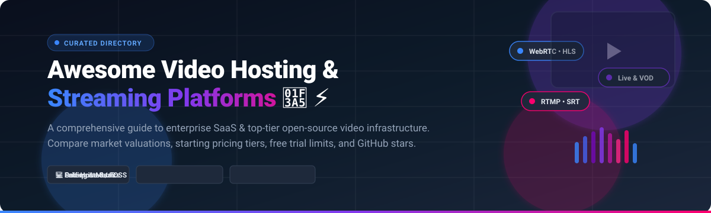

# Awesome Video Hosting & Streaming Platform 🎥 ⚡

  

  
  
  
  
  
  
  

> 🎬 A curated list of top-tier **Video Hosting**, **Live Video Streaming Platforms**, and **Video Content Management Systems (CMS)** — featuring detailed enterprise SaaS solutions (with exact pricing tiers, free tier limits, and valuations) alongside prominent open-source streaming servers and webcasters.  
> 🌟 **Star this repository** if you find it helpful for your media architecture! 🌟

---

## 🔍 SEO & Executive Overview

Whether you are building a modern video-on-demand (VOD) portal, integrating interactive live broadcasts, setting up self-hosted surveillance/media relays, or launching an enterprise training video CMS, choosing the right platform is critical. This guide provides an exhaustive breakdown of:
- **Cloud SaaS Video Platforms**: Vimeo, Brightcove, Kaltura, Panopto, Wistia, Vidyard, Dacast, and SproutVideo.
- **Open-Source Media Servers & Video Portals**: SRS, LiveKit, MediaMTX, PeerTube, Nginx-RTMP, Owncast, MediaCMS, Ant Media Server, AVideo, and Hovod.
- **Key Architectural Protocols**: WebRTC, HLS, LL-HLS, RTMP, SRT, RTSP, and ActivityPub federation.

---

## 📋 Table of Contents 📑

- [🌐 Sector Overview & Market Dynamics](#-sector-overview--market-dynamics)
- [🏢 SaaS / Hosted Commercial Platforms](#-saas--hosted-commercial-platforms)
- [💻 Open-Source Software & Self-Hosted Solutions](#-open-source-software--self-hosted-solutions)
- [📊 Feature Comparison at a Glance](#-feature-comparison-at-a-glance)
- [💖 Support & Sponsorship](#-support--sponsorship)
- [⭐ Star History](#-star-history)
- [🤝 Contributing](#-contributing)
- [📄 License](#-license)

---

## 🌐 Sector Overview & Market Dynamics 📈

The global enterprise video and streaming infrastructure market is estimated at **$115 billion in 2024** and is projected to expand to over **$330 billion by 2030**, advancing at a robust compound annual growth rate (CAGR) of ~19–21%. 

The market dynamics reflect a **moderately fragmented landscape** across distinct verticals (corporate training/LMS video, developer-first streaming APIs, live broadcast OTT, and marketing/sales enablement) rather than a monolithic "winner-take-all" structure, with enterprise incumbents (Brightcove, Kaltura, Panopto, Vimeo) sharing space with specialized developer platforms and federated open-source ecosystems.

---

## 🏢 SaaS / Hosted Commercial Platforms ☁️

Commercial, cloud-hosted enterprise Video Hosting and Live Streaming platforms sorted in descending order by company size (valuation / annual revenue).

| Platform 🏷️ | Company Size (Valuation / Revenue) 💰 | Starting Pricing Tier 💳 | Free Tier / Free Trial Limits 🎁 | Primary Use Case 🎯 | Live Streaming 📡 | Adaptive HLS 🔄 |
|---|---|---|---|---|:---:|:---:|
| **[Vimeo Enterprise](https://vimeo.com)** | **~$1.6B Market Cap** (~$415M ARR) | **$12 /seat/month** (Starter plan billed annually at $144/yr) | **Free Plan**: 3 videos total limit (max 1 GB upload/storage) | Creative collaboration, marketing hosting, & enterprise communication | ✅ (Advanced / Enterprise) | ✅ |
| **[Brightcove](https://www.brightcove.com)** | **~$480M Market Cap** (~$201M ARR) | **$199 /month** (Marketing / Starter entry tier) | **30-Day Free Trial**: up to 10 videos upload limit, player creation & test analytics | High-volume OTT delivery, enterprise media broadcasting, & monetization | ✅ | ✅ |
| **[Kaltura](https://kaltura.com)** | **~$220M Market Cap** (~$175M ARR) | **$100 /month** (Virtual Events / Video Portal starter tier) | **30-Day Free Trial**: includes $100 service credits & up to 10 hosted videos | Comprehensive educational lecture capture & enterprise video CMS | ✅ | ✅ |
| **[Panopto](https://www.panopto.com)** | **~$350M Valuation** (Acquired by K1 Investment) | **$14.99 /month** (Panopto Pro creator tier) | **Free Plan**: 5 hours of video storage & 100 hours of streaming per month | Higher education video learning, searchable lecture CMS, & corporate training | ✅ | ✅ |
| **[Wistia](https://wistia.com)** | **~$80M ARR** (~$500M Est. Valuation) | **$19 /month** (Plus plan billed annually at $228/yr) | **Free Plan**: 10 videos limit, 200 GB monthly bandwidth, 1 channel with 3 collections | Video marketing, lead generation forms, SEO player embeds, & viewer analytics | ❌ | ✅ |
| **[Vidyard](https://www.vidyard.com)** | **~$35M ARR** (~$250M Valuation) | **$19 /seat/month** (Pro plan billed annually at $228/yr) | **Free Plan**: 25 video library limit, unlimited 1:1 video recordings up to 30 mins/video | 1-to-1 sales outreach, video email prospecting, & CRM pipeline tracking | ❌ | ✅ |
| **[Dacast](https://www.dacast.com)** | **~$20M ARR** (~$100M Valuation) | **$39 /month** (Starter plan billed annually at $468/yr) | **14-Day Free Trial**: includes 10 GB bandwidth & 10 GB storage limit | White-label live streaming, pay-per-view monetization, & event broadcasts | ✅ | ✅ |
| **[SproutVideo](https://sproutvideo.com)** | **~$10M ARR** (~$50M Valuation) | **$24.99 /month** (Seed plan; billed monthly) | **30-Day Free Trial**: full feature access, includes 500 GB bandwidth & 500 GB storage | Secure internal company video hosting, marketing capture, & access controls | ✅ | ✅ |

---

## 💻 Open-Source Software & Self-Hosted Solutions 🚀

Curated self-hosted video hosting servers, media proxies, and streaming platforms. Sorted in descending order by **GitHub Stars_Count ⭐**.

### 1. [SRS (Simple Realtime Server)](https://github.com/ossrs/srs) 
- **Tech Stack:** ⚙️ C++ / Go / Python / Docker
- **License:** 📜 MIT License
- **Protocols Supported:** 📡 RTMP, WebRTC, HLS, HTTP-FLV, SRT, MPEG-DASH, GB28181
- **Codecs:** 🎞️ H.264, H.265 (HEVC), AV1, VP9, AAC, Opus
- **Overview:** 💡 An industrial-strength, ultra-high-performance real-time media cluster server widely adopted in Asia and worldwide. Capable of handling massive concurrent live streams with sub-second latency via WebRTC and SRT. Includes built-in AI hooks and WebRTC-to-RTMP conversion.
- **Best For:** 🎯 High-scale live streaming backends, edge CDN clusters, and interactive real-time video infrastructure.

---

### 2. [LiveKit](https://github.com/livekit/livekit) 
- **Tech Stack:** ⚙️ Go / WebRTC / TypeScript / Rust
- **License:** 📜 Apache-2.0 License
- **Protocols Supported:** 📡 WebRTC, WHIP/WHEP, SIP, RTMP Ingest/Egress
- **Codecs:** 🎞️ VP8, VP9, H.264, AV1, Opus
- **Overview:** 💡 A state-of-the-art WebRTC SFU (Selective Forwarding Unit) and end-to-end real-time stack designed for connecting humans, live streaming broadcasts, and real-time multimodal AI agents. Supports distributed multi-node clustering and telemetry out of the box.
- **Best For:** 🎯 Real-time interactive broadcasting, multi-party live conferencing, and ultra-low latency streaming applications.

---

### 3. [MediaMTX](https://github.com/bluenviron/mediamtx) 
- **Tech Stack:** ⚙️ Go (Zero external dependencies)
- **License:** 📜 MIT License
- **Protocols Supported:** 📡 SRT, WebRTC, RTSP, RTMP, LL-HLS, HLS, MPEG-TS, RTP, Media-over-QUIC
- **Codecs:** 🎞️ H.264, H.265, AV1, VP8, VP9, AAC, Opus
- **Overview:** 💡 Formerly known as *rtsp-simple-server*, MediaMTX is a versatile multi-protocol media router and proxy. It automatically transcodes container formats on-the-fly, records streams to disk (fMP4/MPEG-TS), and serves video directly across desktop, mobile, and browser clients with zero external dependencies.
- **Best For:** 🎯 Surveillance camera ingress (RTSP), protocol routing, drone/robotics streaming, and modular live stream relays.

---

### 4. [PeerTube](https://github.com/Chocobozzz/PeerTube) 
- **Tech Stack:** ⚙️ TypeScript / Node.js / Angular / PostgreSQL / FFmpeg
- **License:** 📜 AGPL-3.0 License
- **Protocols Supported:** 📡 ActivityPub, WebTorrent, HLS, P2P WebRTC
- **Codecs:** 🎞️ H.264, AAC
- **Overview:** 💡 The premier decentralized, federated video streaming alternative to YouTube. Developed by Framasoft, PeerTube instances interconnect via ActivityPub, allowing users across different servers to subscribe, comment, and share peer-to-peer browser bandwidth during playback.
- **Best For:** 🎯 Federated public video portals, privacy-first community streaming hubs, and decentralized universities.

---

### 5. [NGINX RTMP Module](https://github.com/arut/nginx-rtmp-module) 
- **Tech Stack:** ⚙️ C / Nginx
- **License:** 📜 BSD 2-Clause License
- **Protocols Supported:** 📡 RTMP, HLS, MPEG-DASH
- **Codecs:** 🎞️ H.264, AAC, MP3
- **Overview:** 💡 The legendary, battle-tested streaming extension for the NGINX HTTP server. It provides live RTMP stream ingest, on-demand playback, real-time HLS fragment generation, and stream recording. The foundational building block underlying countless commercial media architectures.
- **Best For:** 🎯 Lightweight self-hosted RTMP ingest servers and high-concurrency HLS repackaging pipelines.

---

### 6. [Owncast](https://github.com/owncast/owncast) 
- **Tech Stack:** ⚙️ Go / Preact / Tailwind CSS
- **License:** 📜 MIT License
- **Protocols Supported:** 📡 RTMP Ingest, HLS Delivery, ActivityPub (Fediverse)
- **Codecs:** 🎞️ H.264, AAC
- **Overview:** 💡 A single-binary, self-hosted live streaming and interactive chat platform tailored for independent creators. Plug in OBS or Streamlabs via RTMP, and Owncast handles browser HLS playback, built-in live chat, customizable user emotes, bot integrations, and Fediverse notifications.
- **Best For:** 🎯 Independent content creators, game streamers, and organizations wanting an unmonitored Twitch alternative.

---

### 7. [MediaCMS](https://github.com/mediacms-io/mediacms) 
- **Tech Stack:** ⚙️ Python / Django / Celery / Vue.js / FFmpeg
- **License:** 📜 AGPL-3.0 License
- **Protocols Supported:** 📡 HLS Adaptive Streaming, MP4 Progressive Download
- **Codecs:** 🎞️ H.264, AAC
- **Overview:** 💡 A complete turn-key modern video Content Management System designed to mimic YouTube’s frontend and backend workflow. Features multi-resolution automated background transcoding via Celery and FFmpeg, fine-grained RBAC permissions, playlists, and user management.
- **Best For:** 🎯 Corporate internal video portals, educational lecture hubs, and intranet media libraries.

---

### 8. [Ant Media Server](https://github.com/ant-media/Ant-Media-Server) 
- **Tech Stack:** ⚙️ Java / WebRTC / C++
- **License:** 📜 Apache-2.0 License (Community Edition)
- **Protocols Supported:** 📡 WebRTC (~0.5s ultra-low latency), CMAF, HLS, RTMP, RTSP, SRT
- **Codecs:** 🎞️ H.264, H.265, VP8, AAC, Opus
- **Overview:** 💡 A highly scalable real-time streaming engine delivering WebRTC streams with ~500ms latency. Ingests RTMP or RTSP video streams and simultaneously serves WebRTC, CMAF, and HLS to browsers, iOS, and Android applications with automated adaptive bitrate switching.
- **Best For:** 🎯 Live interactive auctions, telehealth, esports broadcasting, and multi-platform low-latency streaming.

---

### 9. [AVideo](https://github.com/WWBN/AVideo) 
- **Tech Stack:** ⚙️ PHP / MySQL / Nginx-RTMP / FFmpeg
- **License:** 📜 GPL-3.0 License
- **Protocols Supported:** 📡 RTMP, HLS, VOD MP4
- **Codecs:** 🎞️ H.264, AAC
- **Overview:** 💡 Formerly known as YouPHPTube, AVideo is an all-in-one open-source audio/video sharing and live streaming solution. It decomposes into dedicated streamer web portals, encoder microservices, and live broadcast ingest nodes.
- **Best For:** 🎯 Full-featured community video portals requiring user channels, paywalls, and VOD + Live under one roof.

---

### 10. [Hovod](https://github.com/Synapsr/Hovod) 
- **Tech Stack:** ⚙️ TypeScript / Node.js / FFmpeg / Docker
- **License:** 📜 MIT License
- **Protocols Supported:** 📡 Multi-quality HLS (360p to 4K), S3-compatible storage
- **Codecs:** 🎞️ H.264, AAC
- **Overview:** 💡 An open-source, self-hosted developer video platform positioned as a lightweight alternative to Mux. Packaged as a single Docker container with zero external dependencies, providing automated multi-quality transcoding, AI transcription/chapters, and optional Stripe billing.
- **Best For:** 🎯 Developers seeking a drop-in video API backend with S3 storage and built-in SaaS billing capabilities.

---

## 📊 Feature Comparison at a Glance ⚡

| Platform / Project 🏷️ | Architecture Type 🏗️ | Primary Stack ⚙️ | Live Streaming 📡 | Adaptive Bitrate HLS 🔄 | Deployment Model 📦 | Best For 🎯 |
|---|---|---|:---:|:---:|---|---|
| **Vimeo Enterprise** | Commercial SaaS | Cloud | ✅ (Advanced) | ✅ | Managed Cloud | Creative collaboration & internal video sharing |
| **Brightcove** | Commercial SaaS | Cloud | ✅ | ✅ | Managed Cloud | Large-scale OTT media & enterprise broadcasters |
| **Kaltura** | Commercial / Hybrid | Cloud / On-Prem | ✅ | ✅ | Enterprise Cloud / On-Prem | Higher education video CMS & virtual summits |
| **Panopto** | Commercial SaaS | Cloud | ✅ | ✅ | Managed Cloud | University lecture capture & corporate training |
| **Wistia** | Commercial SaaS | Cloud | ❌ | ✅ | Managed Cloud | B2B video marketing & lead generation |
| **Vidyard** | Commercial SaaS | Cloud | ❌ | ✅ | Managed Cloud | Sales outreach prospecting & email tracking |
| **Dacast** | Commercial SaaS | Cloud | ✅ (Live-first) | ✅ | Managed Cloud | White-label live events & pay-per-view VOD |
| **SproutVideo** | Commercial SaaS | Cloud | ✅ | ✅ | Managed Cloud | Secure business hosting & marketing analytics |
| **SRS** | Open-Source Core | C++ / Go | ✅ (Cluster) | ✅ | Self-Hosted / Docker / K8s | Massively scalable real-time streaming backend |
| **LiveKit** | Open-Source SFU | Go / WebRTC | ✅ (WebRTC) | ✅ (Simulcast) | Self-Hosted / Distributed Cloud | Real-time interactive video & AI audio/video agents |
| **MediaMTX** | Open-Source Proxy | Go | ✅ (Zero-dep) | ✅ (LL-HLS) | Single Binary / Docker | Multi-protocol media routing & CCTV/RTSP ingress |
| **PeerTube** | Open-Source Portal | TS / Node / Angular | ✅ (P2P) | ✅ | Docker / VPS | Decentralized ActivityPub federated video network |
| **NGINX RTMP** | Open-Source Server | C / Nginx | ✅ (RTMP) | ✅ | Linux / Nginx module | Battle-tested RTMP ingest & HLS segmenter |
| **Owncast** | Open-Source Stream | Go / Preact | ✅ (Single-user) | ✅ | Single Binary / Docker | Creator live streaming with integrated chat |
| **MediaCMS** | Open-Source CMS | Python / Django | Limited | ✅ | Docker Compose | YouTube-style self-hosted enterprise portal |
| **Ant Media Server** | Open-Source / Dual | Java / WebRTC | ✅ (<0.5s) | ✅ | Docker / Cloud Marketplace | Ultra-low latency WebRTC streaming & auctions |
| **AVideo** | Open-Source Portal | PHP / MySQL | ✅ (RTMP) | ✅ | Docker / LEMP Stack | Turnkey self-hosted VOD & live broadcast network |
| **Hovod** | Open-Source API | TypeScript / Node | ❌ (VOD-first) | ✅ (360p-4K) | Single Docker container | Self-hosted Mux alternative with S3 storage |

---

## 💖 Support & Sponsorship

Thank you so much for exploring and using this curated list! Creating and maintaining comprehensive guides like this takes continuous research, benchmarking, and dedication. 

If this project has saved you time, informed your engineering decisions, or helped you architect your video streaming stack, please consider supporting the project:
- ⭐ **Star this repository** to help others find it.
- 🍴 **Fork and share** it with your developer and engineering community.
- ☕ **Buy a coffee / Sponsor the author**: Support ongoing open-source curation and developer tools directly via the [GitHub Sponsors Dashboard](https://github.com/sponsors/ishandutta2007).

Your support is deeply appreciated and keeps projects like this actively maintained! 🙌

---

## ⭐ Star History

---

## 🤝 Contributing 💡

Contributions and additions are enthusiastically welcomed! If you operate or maintain an active open-source video hosting or streaming project, please submit a pull request:

1. 🍴 **Fork** this repository.
2. 🌿 Create your feature branch (`git checkout -b feature/new-video-platform`).
3. 📝 Add your project under the appropriate section with its name, Stars_Count badge, license, stack, and use case.
4. 🚀 Commit your changes (`git commit -m "Add NewVideoPlatform to open-source directory"`).
5. 📤 Push to the branch (`git push origin feature/new-video-platform`).
6. 📬 Open a **Pull Request**.

---

## 📄 License ⚖️

This curated compilation is released under the creative commons [CC0 1.0 Universal (Public Domain)](file:///C:/Users/hp/Documents/Projects/Awesome-Video-Hosting-Streaming-Platform/LICENSE). Individual software projects, logos, and platforms remain the intellectual property and copyright of their respective authors and owners.

---

  ⭐ <b>Found this resource helpful? Consider starring the repository to help others discover it!</b> ⭐

